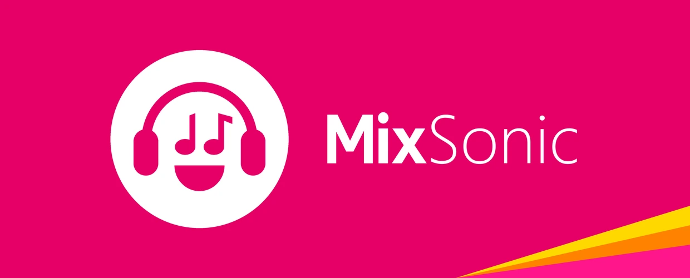
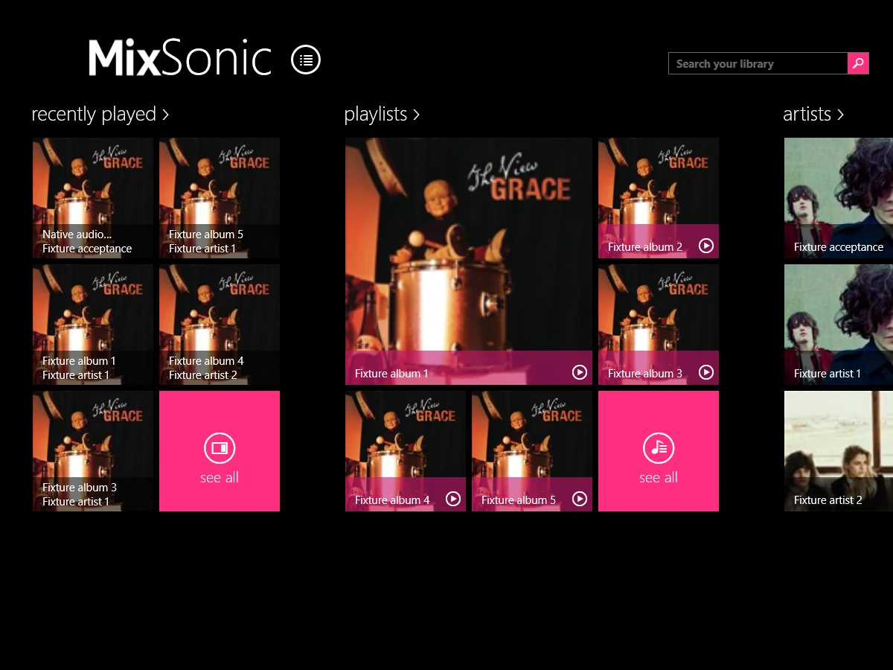
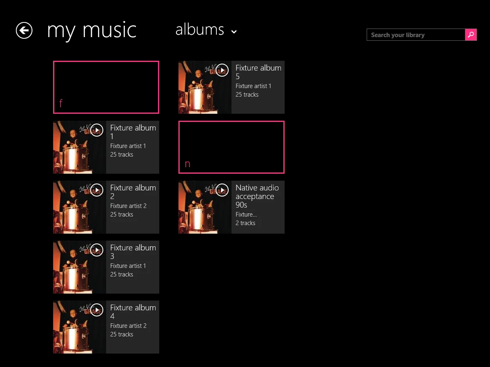
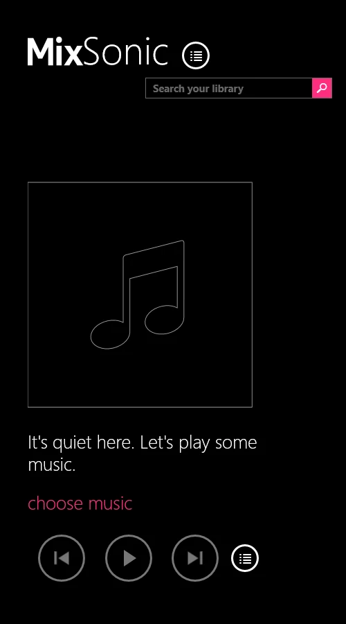
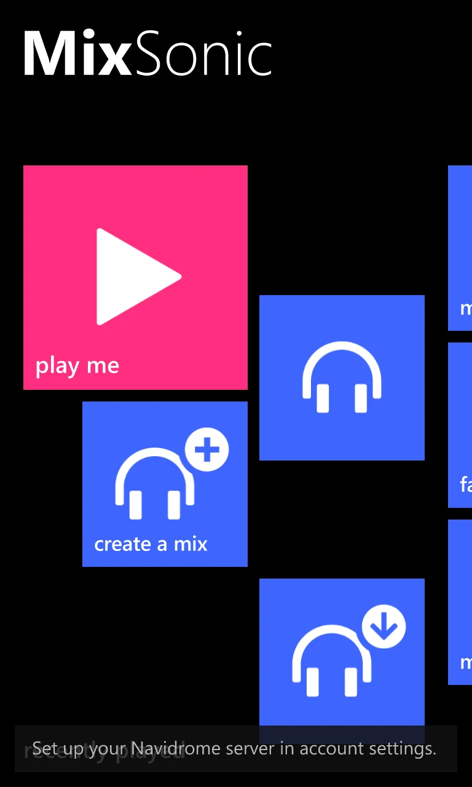
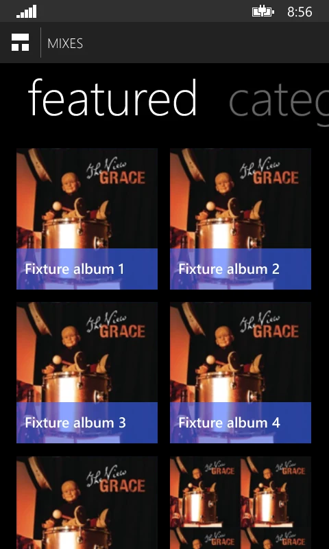
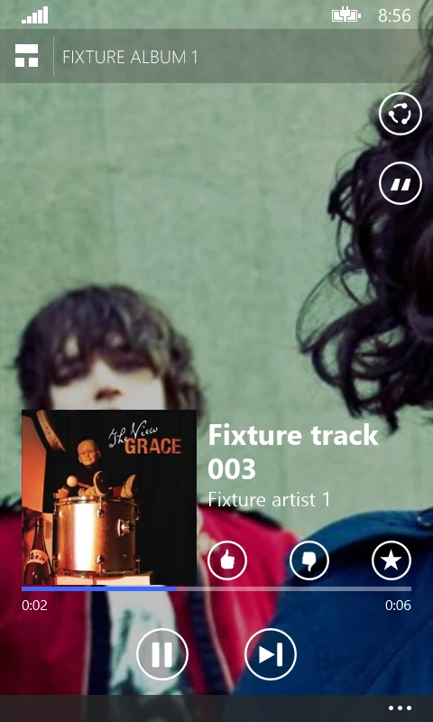
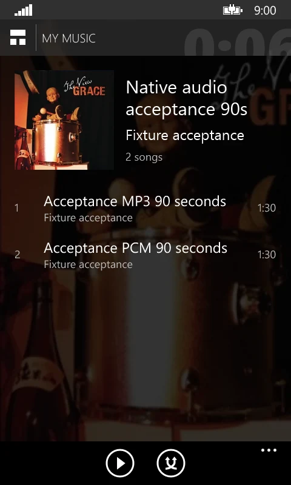

<div align="center">
  

  <br /><br />

  <a href="https://github.com/A-BenLi06/MixSonic/releases/tag/v2.0.0.0">
    
  </a>
  
  
  

  <h3>Native Metro Music Client for Navidrome &amp; Subsonic</h3>

  <p>
    Bringing the expressive typography, live tile warmth, and fluid spatial design of MixRadio
    to self-hosted music libraries on Windows Desktop and Windows Phone 8.1.
  </p>

  <p>
    <a href="#features">Features</a> &bull;
    <a href="#screenshots">Screenshots</a> &bull;
    <a href="#downloads--installation">Downloads</a> &bull;
    <a href="#architecture--building">Building</a> &bull;
    <a href="#brand--identity">Brand</a>
  </p>
</div>

---

## Overview

**MixSonic** is a native C#/XAML WinRT music player built for **Navidrome**, **OpenSubsonic**, and compatible **Subsonic** servers. Designed for both **Windows 8.1 / Windows 10 Desktop** and **Windows Phone 8.1 / Windows 10 Mobile**, it combines full Navidrome protocol fidelity with a curated Metro UI inspired by MixRadio.

No Electron wrappers, no webviews—just fast native XAML views, offline caching, background audio, and keyboard/touch-first navigation.

---

## Features

- **Complete Navidrome Library Discovery**
  - Browse **Albums** (newest, recent, frequent, random, starred, top rated, by year or genre), **Artists**, **Songs**, **Genres**, **Playlists**, and **Internet Radio** with full pagination and zero silent 20/500-item truncation.
  - Multi-music-folder selector retained across browsing and typed category search.
- **Mixes, Queue & Playback Fidelity**
  - Instant **Play Me** shuffle mixes, **Create a Mix** discovery workflows, full queue management (play next, append, reorder, remove, shuffle, repeat), and server queue save/restore preserving duplicate tracks.
  - **0–5 Ratings & Favorites** on tracks, albums, and artists, **Bookmarks** with millisecond precision, server **Sharing** links, and **Jukebox** remote control when supported by the server.
- **Offline Mixes & Downloads**
  - Download tracks, albums, artwork, and lyrics into an isolated account-scoped offline catalog for uninterrupted listening on Desktop and Phone, with checksum/size validation and original-file export.
- **Synchronized Lyrics & Accurate Listening Activity**
  - Multi-variant and timestamped lyric support alongside honest scrobbling and recent listening history with automatic offline retry.
- **Responsive Metro Experience**
  - Desktop hub scales smoothly from wide panorama layouts down to compact/snapped player views; Windows Phone 8.1 runs with dedicated WinRT background audio and high-contrast lock-friendly controls.
  - Built-in **English (`en-US`)** and **Simplified Chinese (`zh-CN`)** localization.

---

## Screenshots

All screenshots below are real captures from running builds connected to a test fixture—no mockups or composite edits.

### Desktop (Windows 8.1 / Windows 10)

| Home Hub | My Music — Grouped Albums | Compact / Snapped Mode |
| :---: | :---: | :---: |
|  |  |  |

### Mobile (Windows Phone 8.1)

| Home Hub | Mixes &amp; Categories | Now Playing | Album Detail |
| :---: | :---: | :---: | :---: |
|  |  |  |  |

---

## Brand &amp; Identity

<p align="left">
  
</p>

MixSonic's identity pairs the classic geometric headphone smiley &amp; musical note mark with pure-black (`#000000`) surfaces, vibrant magenta accents (`#E60067`), and warm yellow-orange Metro highlights (`#FF8200` / `#FFD800`).

The wordmark combines bold vector **Mix** letterforms paired tightly with `Segoe WP Light` **Sonic**. Package identities (`A-BenLi06.Mixdrome` / `A-BenLi06.Mixdrome.Phone`) remain stable for upgrade compatibility while display strings, manifests, tiles, and splash screens ship unified under **MixSonic**. See [`docs/branding.md`](docs/branding.md) for asset generation (`tools/branding/generate.py`) and scale specifications.

---

## Downloads &amp; Installation

Pre-built signed AppX release packages for **v2.0.0.0** are available on the [Releases page](https://github.com/A-BenLi06/MixSonic/releases/tag/v2.0.0.0):

| Package | Target Platform | Architectures | Checksum / Manifest |
| --- | --- | --- | --- |
| `Mixdrome-v2.0.0.0.zip` | Windows 8.1 Store / Windows 10 | `AnyCPU` | [`release-manifest.json`](https://github.com/A-BenLi06/MixSonic/releases/download/v2.0.0.0/release-manifest.json) |
| `Mixdrome.Phone-v2.0.0.0.zip` | Windows Phone 8.1 / W10M | `ARM`, `x86` | [`phone-release-manifest.json`](https://github.com/A-BenLi06/MixSonic/releases/download/v2.0.0.0/phone-release-manifest.json) |

### Sideloading Notes

1. Verify the downloaded `.zip` SHA-256 against the corresponding release manifest and confirm the bundled `SigningCertificate.cer` (`CN=benli06`, SHA-256 `d20c42b88c4e07fe427f806ce18ef1724966bc4c965fb31154e2e2f198ebb36c`).
2. **Desktop**: Install `SigningCertificate.cer` into `LocalMachine\TrustedPeople` (or `Root`), install dependencies, and deploy `Mixdrome.appx` via `Add-AppxPackage`. Full step-by-step commands live in [`docs/releasing.md`](docs/releasing.md).
3. **Windows Phone 8.1**: Deploy `ARM/Mixdrome.Phone_2.0.0.0_ARM.appx` to physical devices (or `x86/Mixdrome.Phone_2.0.0.0_x86.appx` to x86 emulators) using Windows Phone Application Deployment (`AppDeployCmd.exe`) or Device Portal.
4. **Audio note on Windows 10**: If Windows 10 audio fails due to exclusive-mode driver locks in Microsoft Player Framework, turn off exclusive mode under Sound &rarr; Playback Properties &rarr; Advanced, or switch the output device to `16 bit, 48000 Hz`.

---

## Architecture &amp; Building

The solution (`Mixdrome.sln`) targets the legacy Windows 8.1 / Windows Phone 8.1 toolsets:

- `Client/Mixdrome.csproj` — Windows 8.1 Store XAML Desktop client
- `Client.Phone/Mixdrome.Phone.csproj` — Windows Phone 8.1 WinRT XAML client
- `Client.Phone.BackgroundAudioTask/Mixdrome.Phone.BackgroundAudioTask.csproj` — Out-of-process background audio agent
- `Client.Common/` &amp; `Common/` — Shared Subsonic/OpenSubsonic API client, offline storage, queue, scrobbling, and audio services

### Prerequisites &amp; Verification

Building full `.appx` packages requires **Visual Studio 2015 / MSBuild 14.0**, **Windows 8.1 SDK**, and **Windows Phone 8.1 SDK** on Windows.

```powershell
# Desktop CLR tests & source checks
pwsh -ExecutionPolicy Bypass -File ./tools/ci/run-desktop.ps1

# Python source, Phone audit, Navidrome baseline & release tooling checks
python tools/ci/check.py
```

Documentation &amp; developer guides:
- [`CONTRIBUTING.md`](CONTRIBUTING.md) — Branching, commit identity, PR checks, and walkthrough policy
- [`docs/navidrome/implementation.md`](docs/navidrome/implementation.md) &amp; [`docs/navidrome/acceptance.md`](docs/navidrome/acceptance.md) — Navidrome functional spec &amp; 115-case acceptance baseline
- [`docs/mixradio/reference-analysis.md`](docs/mixradio/reference-analysis.md) &amp; [`docs/mixradio/acceptance-workflow.md`](docs/mixradio/acceptance-workflow.md) — Desktop &amp; Phone MixRadio layout and quality workflow
- [`docs/releasing.md`](docs/releasing.md) — Signed AppX build, manifest verification, and CD publishing

---

## Credits &amp; Attribution

- **Maintainer**: [**A-BenLi06**](https://github.com/A-BenLi06) &lt;ben_li06@outlook.com&gt;
- **Upstream Origins**: Built on [Subsonic8](https://github.com/AlexSorokoletov/Subsonic8) by Alex Sorokoletov, extended for Navidrome &amp; OpenSubsonic compatibility, and visually inspired by MixRadio.
- Original authorship and license notices remain intact in the repository. Upstream Navidrome protocol contracts are implemented independently without vendoring GPL server code or bundling proprietary MixRadio packages.
