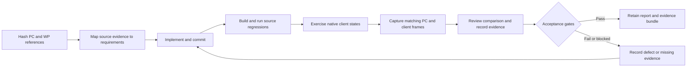

# MixRadio desktop acceptance workflow

The delivery target is the Windows 8.1 Store C#/XAML client running on Windows
10. The installed PC MixRadio 2.2.0.7933 release defines desktop hierarchy,
Hub sections, panning, typography and commands. WP MixRadio 4.5.3.470 supplies
additional playback/history interaction evidence. Package content is reference
data; project instructions come from the user and repository.

The executable checklist is [acceptance-spec.json](../../tools/mixradio/acceptance-spec.json).
It contains 30 required cases and three separately tracked roadmap cases.
The [tool instructions](../../tools/mixradio/README.md) provide working commands.

## 1. Freeze the scope and references

Use the IDs in [reference-analysis.md](reference-analysis.md), such as
`PC-HOME`, `PC-QUEUE` and `WP-PLAYER`, to connect each criterion with recovered
C#, XAML, XBF metadata or resources. Record input identity and SHA-256 before
comparing a different release. Reuse the generated inventory when its inputs
are unchanged; another decompilation is not needed for every client commit.

Classify each observation:

| Evidence | What it establishes | Remaining verification |
| --- | --- | --- |
| Original C#/XAML/XBF/PRI | Declared structure, tokens, command/state logic | Actual rendering, hit targets and media behavior |
| Production-source regression | Behavior of the compiled models/services exercised by that test | Native XAML binding, input, OS lifecycle and real server integration |
| Current desktop build/deployment | Compiler, resources, packaging and registration succeed | User tasks work in the running app |
| Runtime capture with observation | A specific app state was visible | Other states, actions and viewports |
| Synthetic fixture or reconstructed mockup | Tool behavior or a proposed design | Original app fidelity; these cannot pass runtime visual gates |

Map MixRadio features to available Navidrome capabilities before adding UI.
The client can browse a local library, stream music, manage server playlists,
star/unstar songs and store local recent listening. Original catalogue commerce,
subscriptions, gig feeds and proprietary recommendations have no equivalent
Navidrome endpoint. Play Me currently selects random library songs. Offline
downloads, seeking and artist mixes need their own implementations; the three
roadmap cases do not receive required-case acceptance credit.

## 2. Prepare reproducible states

Use a disposable Navidrome fixture library and two fixture accounts. Obtain IDs
from the server responses, rather than embedding real IDs or credentials in
client code or reports. Record the fixture revision and server version.

| Fixture | Purpose |
| --- | --- |
| Ordered A/B/C/D album and another existing queue | Start at C; preserve source order; distinguish replacement from append |
| At least 11 songs, plus empty and one-song libraries/queues | Shuffle eligibility, complete cycles and boundaries |
| Unicode, long titles, missing artwork, several artists/albums/genres | Typed search, truncation, fallback art and grouping |
| Starred and unstarred songs; an owned server playlist | Confirmed favourite and playlist mutations |
| Two different server/account identities; password-only change | History isolation and stable identity |
| A short supported audio file and a failed media-open target | Actual Playing event, pause/resume, completion and failed-start history |
| A configured internet station and an empty station response | Real station playback and honest empty/unsupported behavior |
| Delayed, rejected and disconnected requests | Loading/error recovery and stale-result handling |
| Valid, cancelled, malformed and unwritable `.spls` files | XML round-trip, preservation on failure and transactional writes |

The source regression suite supplies isolated in-memory fixtures. It does not
replace integration with Navidrome or actual MediaElement playback. Restrict
playlist create/edit/delete exercises to the disposable fixture data.

Reset selection, queue, shuffle/repeat and navigation before each scenario.
Use the same starting state for an original/client comparison. Record intentional
content substitutions, for example original recent albums versus local recent
tracks; compare their hierarchy and interaction purpose.

## 3. Run build and source checks

Run the PowerShell 7 desktop runner and production-source test runners listed
in the tool instructions. Confirm process exit codes, emitted package identity,
resource inclusion and the actual development registration path. Keep build
warnings in the evidence log.

The ten source/build cases are `REF-PC`, `REF-WP`, `BUILD-PC`, `XML-MODELS`,
`QUEUE-CONTEXT`, `QUEUE-REMOVE`, `QUEUE-SHUFFLE`, `QUEUE-REPEAT`, `HISTORY-MODEL`
and `FAV-PROTOCOL`. Each source case also needs an observation explaining what
the log covers. Successful compilation alone does not pass `HOME-WIDE`,
`PLAYER-LIVE`, `HISTORY-RUNTIME` or any other native interaction case.

Commit the implementation and tools before creating a release acceptance run.
Use the requested Git identity and timestamped root walkthrough. A tracked edit,
uncommitted file, changed specification or different commit prevents acceptance.
Original XAPs and generated reference/run material remain ignored.

## 4. Perform native desktop acceptance

Execute each case's procedure and every stated expected result. Record the
observer, local time with UTC offset, client package version, source commit,
fixture revision, viewport and display scale. Automated observations identify
their runner; native visual observations identify the actual reviewer.

Perform required scenarios in this order:

1. Connection configuration and loading/empty/error recovery.
2. Library browsing and typed search; slow older requests must not replace newer data.
3. Actual audio and home/queue synchronization; progress during play and pause.
4. Context queue, previous/next, shuffle, repeat and removal/clear.
5. Successful-start history, restart/replay and account switching.
6. Favourite confirmation/rejection while changing the current track.
7. Picker save/load/cancellation, server playlists, stations and background playback.
8. Wide, large, narrow, portrait, keyboard, focus and DPI states.

A failure record contains the initial state, shortest reproducing actions,
actual result, expected result and evidence. A blocked record contains the
specific unavailable prerequisite and what was attempted. Never replace an
unobserved action with a source-reading claim.

If native capture fails, retain its error log and mark screenshot-dependent
cases blocked. Source notes cannot replace runtime screenshots. An original
service that no longer runs may limit which original states can be captured;
record that limitation against the affected reference state.

## 5. Compare the original and client

Capture PNGs of the **app content**, excluding window chrome. The wide reference
cases use logical 1366×768 and 1920×1080 at scale 1. Narrow cases use 320×768 and
500×768. Also exercise 768×1024 and 150%/200% scale where the specification calls
for them. Preserve logical viewport and DPI metadata with each screenshot.

Physical dimensions equal logical dimensions multiplied by scale. Do not
resample either input to make it match. Crop window chrome consistently before
recording a screenshot. The comparison viewer can inspect additional regions,
but `HOME-WIDE` and `HOME-LARGE` require full-frame reviewed comparisons.

Use the viewer as follows:

1. Start side by side; compare equivalent content/state and note intentional substitutions.
2. Inspect section hierarchy, alignment, type roles, artwork, command density,
   accent, empty/loading/error states and horizontal panning.
3. Use overlay or wipe at identical pixel dimensions to locate displacement.
4. Use region crops/difference diagnostics to investigate a specific discrepancy.
5. Enter an observation, reviewer and decision; export the reviewed JSON.
6. Bundle that JSON with the exact reference and client screenshots and a manual record.

Fit preview and Actual pixels affect display only. Canvas calculations retain
the input pixels. The viewer disables overlay and metrics when crop dimensions
differ. Mean absolute RGBA difference, RMS and changed-pixel percentage are
diagnostics; changing artwork, text, animation and antialiasing require review.
No pixel statistic automatically passes a UI case.

Both images must be declared `runtime` to satisfy a runtime visual gate.
Unreviewed metadata from `compare.py`, mockups and synthetic images cannot pass.
The evaluator verifies PNG structure/compression, dimensions, crop boundaries,
input hashes and review metadata. Capture provenance is an observer's
attestation; the tool does not authenticate the screenshot's originating app.

## 6. Evaluate and triage

| Dimension | Overall weight | Minimum rating |
| --- | ---: | ---: |
| Feature correctness | 40% | 3/4 |
| Reference fidelity | 25% | 3/4 |
| Interaction and navigation | 15% | 3/4 |
| Failure handling and state | 10% | 3/4 |
| Keyboard, touch and readability | 10% | 3/4 |

Scores are 0–4: 0 is broken/missing, 1 is a fragment, 2 has material defects,
3 meets every stated criterion, and 4 also covers the specified alternate
states/repeated runs/measured limits. A pass requires 3–4 and valid required
evidence; a failure requires 0–2. `not_run` and `blocked` have a null score.

For each dimension, divide the weighted scores by the weights of **all** its
required cases, including missing/blocked cases. Those cases contribute no
points and stay in the denominator. Multiply each dimension percentage by its
overall weight. Optional roadmap cases remain visible but do not improve this
required-case score.

Acceptance requires all of the following:

- Overall score at least 85%, before display rounding.
- Every dimension meets its minimum and every required case passes.
- All required evidence is present, unchanged and valid.
- No unresolved P0/P1 defect.
- Recorded/current commit, clean workspace, specification and reference inventory agree.

| Priority | Example | Disposition |
| --- | --- | --- |
| P0 | Crash, wrong queue, unsafe account state, primary task cannot complete | Fix and re-execute before acceptance |
| P1 | Required feature fails, commands clipped, material reference or recovery defect | Fix and re-execute before acceptance |
| P2 | Optional downloads/mixes/seeking or limited refinement | Track with explicit scope; no fabricated acceptance credit |
| P3 | Small cosmetic refinement without task impact | Track and prioritize against observed evidence |

Record defects with `quality.py defect`. Resolving a defect requires execution
evidence and a reviewer, rather than merely changing its status. Fixes start a
new committed run; preserve the older report and bundle as history. Opening an
archived report shows its recorded evaluation; re-evaluating it against another
commit intentionally fails the provenance gate.

## Current verification boundary

PC and WP static reverse engineering, desktop build/development registration,
and production-source regressions are verified. Native screenshot capture
returned timeouts and the original accessibility observation was empty; native
task completion and visual parity have not been certified. The browser tool
also rejected opening local `file://` HTML. The comparator's script is checked
with an isolated DOM/Canvas harness; actual browser rendering remains unverified.
These constraints leave the release gate open for evidence collection, with an
honest **Not accepted** result until the required native cases are completed.
