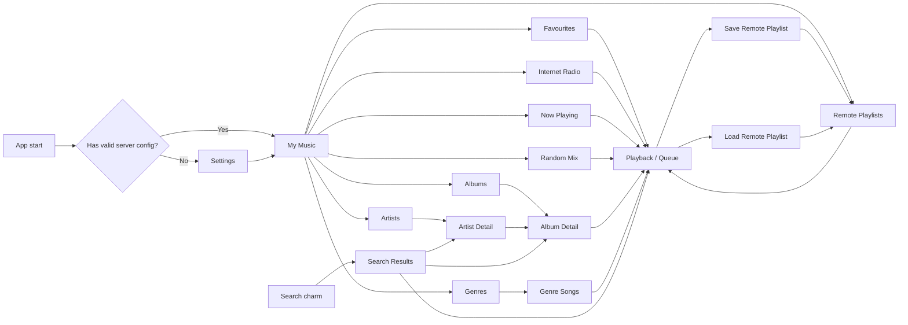

# SubSonic8 / Navidrome Windows 8.1 + Windows Phone 8.1 Client UI Structure

这份说明用于发给 Stitch 做 UI 调整。目标是把当前通用 Windows 8.1 Navidrome 客户端，整理成一个参考 MixRadio 的 Metro 音乐应用界面。

## 设计目标

- 桌面平台：Windows 8.1 Store / Metro，横向大画布、触控优先、底部 AppBar 命令。
- 手机平台：Windows Phone 8.1，按 WP 版 MixRadio 独立调整，纵向单手流、底部 CommandBar、系统 Back。
- 风格参考：桌面按 MixRadio Windows 8.1 横向 hub；手机按 Windows Phone 版 MixRadio，不缩放桌面版。
- 视觉方向：黑色或艺人照片背景，大号白色标题，粉色/青色/黄色高饱和强调色，内容优先，少 chrome。
- 首屏必须是可用的音乐客户端首页，不做营销落地页。
- 控件用图标表达命令：播放、添加、列表、搜索、设置、删除、重命名、随机、收藏等。
- 保留 Windows 8.1 的横向滚动 collection，而不是现代 Fluent / Web dashboard。

## Stitch 投喂版摘要

这是一个 Navidrome / Subsonic 音乐客户端，不是播放器皮肤展示页。UI 需要直接围绕“浏览音乐库、搜索、播放、管理队列、远程歌单、收藏、电台、服务器当前播放状态”设计。

### 端侧设计分工

| 端 | 设计方向 | 页面模式 | 命令位置 | 不要做 |
| --- | --- | --- | --- | --- |
| Windows 8.1 Store | MixRadio 横向 Metro hub | 大横向画布、GridView tile wall、沉浸播放页、Settings flyout | 底部 AppBar / Search charm / Settings charm | 不要做 Web dashboard、Fluent 导航栏、现代侧边栏 |
| Windows Phone 8.1 | Windows Phone 版 MixRadio | 单手纵向 home、单列列表、全屏封面播放页、彩色 hub tile | 底部 CommandBar / 系统 Back | 不要把桌面横向 GridView 缩小到手机 |

### 核心功能模块

| 模块 | 数据来源 / API | 桌面入口 | 手机入口 | 必须设计的状态 |
| --- | --- | --- | --- | --- |
| 登录与设置 | 本地配置 + `ping` | Settings charm / Settings flyout | SettingsPage | 未配置、连接失败、保存成功 |
| 首页 / My Music | `getMusicFolders` + library command | Main hub tile wall | WP MixRadio home | 加载中、离线、空库 |
| Albums | `getAlbumList2` / `getAlbum` | Albums tile -> Album Detail | albums tile -> AlbumPage | 有封面、无封面、空状态 |
| Artists | `getArtists` / `getArtist` | Artists tile -> Artist Detail | artists tile -> ArtistAlbumsPage | 字母列表、无艺人图 |
| Genres | `getGenres` / `getSongsByGenre` | Genres tile -> Genre Songs | genres tile -> GenreSongsPage | 彩色分类、歌曲为空 |
| Random Mix | `getRandomSongs(size=50)` | 粉色 Random Mix / play tile | 粉色 `play me` | 可播放队列、加载失败 |
| Search | `search3` | Windows Search charm -> SearchView | SearchPage 青色输入条 | Searching、No results、Grouped results |
| Playback / Queue | 播放队列 + background audio | PlaybackView | PlaybackPage | 音频、视频、暂停、空队列 |
| Remote Playlists | `getPlaylists` / `getPlaylist` / create-update-delete | Manage / Save Playlist | PlaylistsPage | 当前服务器歌单为 0 的空状态 |
| Favourites | `getStarred2` | Favourites tile | favourites tile | 有收藏、No favourites yet |
| Internet Radio | `getInternetRadioStations` | Radio tile | radio tile | 2 个电台、无封面、电台为空 |
| Now Playing | `getNowPlaying` | Now Playing tile | now playing tile | 当前为空、有人播放时的用户/歌曲/时间 |

### 页面结构总览

| 页面 | Windows 8.1 Store 结构 | Windows Phone 8.1 结构 |
| --- | --- | --- |
| Home / My Music | 黑色大画布；左侧 now-playing / brand 区；右侧 library tile wall；横向滚动 | 全屏照片背景；`MixRadio` wordmark；`my music`；青色搜索条；粉色 `play me`；彩色 hub tile；下方专辑单列 |
| Browse Collection | PageHeader + 横向 GridView + tile card + 底部 AppBar | 大标题 + 单列 ListView，必要时两列小 tile |
| Album Detail | 左侧大封面或背景，右侧歌曲 grid/list，底部 play/add 命令 | 全屏专辑封面背景，前景封面，歌曲单列，底部 play all / shuffle |
| Search | 大标题 + Busy/Empty/Grouped results，结果按 Artists/Albums/Songs 分组 | 青色搜索输入条固定靠上，结果单列分组向下滚动 |
| Playback | 封面模糊背景，当前曲目，队列，底部播放控制和队列命令 | 全屏封面背景，大封面，大号曲名，底部 previous/play/next，粉色 play/pause |
| Settings | Settings flyout，紧凑表单，粉色 Save | 单列设置页，底部 CommandBar 或粉色 Save |

### Stitch 需要优先输出的设计稿

1. Windows 8.1：Home / My Music。
2. Windows 8.1：通用 Browse Collection 模板。
3. Windows 8.1：Playback / Queue。
4. Windows 8.1：Search Results 三状态。
5. Windows Phone 8.1：MainPage，严格参考 WP MixRadio。
6. Windows Phone 8.1：AlbumPage。
7. Windows Phone 8.1：PlaybackPage。
8. Windows Phone 8.1：SearchPage。
9. Windows Phone 8.1：Artists / Genres / Playlists / Favourites / Radio / Now Playing 通用列表模板。

## 当前服务器能力

测试服务器是 Navidrome v0.58.5，通过 Subsonic REST API 工作。UI 稿里不要展示账号或密码。

已验证可用的数据面：

- Subsonic API ping：ok。
- Music folders：1 个。
- Artists：211 位，分布在 15 个索引段。
- Genres：17 个。
- Albums：`getAlbumList2` 可取专辑墙。
- Random songs：可取随机歌曲。
- Playlists：接口可用，但当前歌单数为 0，需要空状态。
- Starred/Favourites：接口可用，当前有少量收藏数据。
- Internet radio：接口可用，当前有 2 个电台。
- Now playing：接口可用，当前无人播放，需要空状态。
- Scan status：接口可用，当前未扫描，库内项目数约 2749。
- Shares：服务器返回 501，不建议在 UI 中放分享入口。

## 功能结构

### 1. 配置与登录

用途：连接 Navidrome / Subsonic 服务器。

字段与功能：

- Primary URL：主服务器地址，例如内网地址。
- Secondary URL：备用服务器地址，例如公网/DDNS 地址。
- Username。
- Password。
- Enable notifications on song change。
- Compatible Mode：把无损转码为 MP3 320kbps。
- Save：保存后自动选择可用路由并回到首页。
- Privacy Policy：系统设置面板中的辅助入口。

UI 建议：

- 作为 Windows 8.1 Settings charm / settings flyout。
- 表单紧凑、暗色背景、白色标签，保存按钮用 MixRadio 粉色。
- 服务器地址错误、缺少用户名/密码时显示明确错误状态。

### 2. 首页 / My Music

用途：音乐库入口页。

主入口卡片：

- Albums：进入专辑墙。
- Artists：进入艺术家列表。
- Genres：进入流派列表。
- Random Mix：生成随机 50 首歌曲列表。
- Playlists：进入远程歌单列表。

UI 建议：

- 使用 MixRadio hub 风格，不要普通表格。
- Random Mix 可以做最大、最醒目的粉色播放卡片，类似 “play me”。
- Albums / Artists / Genres / Playlists 用不同强调色和大图标。
- 横向滚动布局，卡片可大小变化，但每个卡片触控面积要稳定。
- 首页可预留 Favourites / Radio / Now Playing 入口，但标为二期或服务器扩展模块。

### 3. 专辑

页面：

- Album Wall：专辑列表。
- Album Detail：专辑歌曲列表。

数据：

- `getAlbumList2(type=alphabeticalByName, size=500)`。
- `getAlbum(id)`。
- 封面来自 `getCoverArt(id)`。

行为：

- 点专辑进入专辑详情。
- 点歌曲：把当前页面的歌曲从点击项开始加入队列并开始播放。
- 多选专辑或歌曲：底部 AppBar 可 Add to playlist / Play all。

UI 建议：

- Album Wall 使用方形封面 tile。
- 标题/艺术家/曲目数放在底部半透明或强调色 caption band。
- Album Detail 可以有左侧大封面/背景图，右侧歌曲列表，也可以继续使用横向 Metro grid。

### 4. 艺术家

页面：

- Artists：全部艺术家。
- Artist Detail：某艺术家的专辑列表。

数据：

- `getArtists()`。
- `getArtist(id)`。

行为：

- 点艺术家进入艺术家详情。
- 艺术家详情里点专辑进入 Album Detail。
- 多选艺术家时，Play all 会递归加载其专辑/歌曲加入队列。

UI 建议：

- Artists 可以做 MixRadio 的文字/图像混合卡片。
- 没有艺人图时用纯色 tile + 大号艺人首字母或图标。
- Artist Detail 建议使用大标题和艺人背景图占位，下面是专辑 tile wall。

### 5. 流派

页面：

- Genres：流派列表。
- Genre Songs：某流派歌曲列表。

数据：

- `getGenres()`。
- `getSongsByGenre(genre)`。

行为：

- 点流派进入该流派歌曲列表。
- 点歌曲开始播放当前流派 mix。

UI 建议：

- Genres 用 MixRadio “featured categories” 方向：深色背景 + 彩色分类卡片。
- 每个卡片显示流派名、歌曲数、专辑数。
- 可以使用青色/黄色/粉色轮换色块。

### 6. Random Mix

页面：

- Random Mix：随机 50 首歌曲。

数据：

- `getRandomSongs(size=50)`。

行为：

- 进入页面即加载随机列表。
- 点任意歌曲会从该歌曲开始播放整个随机队列。

UI 建议：

- 页面视觉接近 MixRadio 的 “play me”。
- 顶部放醒目的随机播放按钮/状态。
- 内容区显示歌曲 tile/list，强调这是可立即播放的 mix。

### 7. 搜索

入口：

- Windows Search charm。

页面状态：

- Searching...
- No results were found...
- Results found。

数据：

- `search3(query)`。

结果分组：

- Artist(s)。
- Album(s)。
- Song(s)。

行为：

- 点艺术家/专辑进入对应详情。
- 点歌曲开始播放搜索结果中的歌曲队列。
- 多选结果可添加到播放列表或播放全部。

UI 建议：

- 搜索页需要单独模板，因为结果按组横向展示。
- 可参考 MixRadio 搜索：深色或照片背景，顶部大搜索标题，结果用干净列表/卡片分组。
- 空状态要有明确但克制的提示。

### 8. 播放队列 / Playlist

页面：

- Playback / Playlist 主播放页。
- Audio 状态。
- Video 状态。
- FullScreen video 状态。
- Filter 状态。
- Snapped audio/video 状态。

核心功能：

- 当前播放项。
- 播放队列。
- 播放/暂停、上一首、下一首、停止。
- Repeat。
- Shuffle。
- 清空队列。
- 队列内搜索过滤。
- 本地保存队列文件。
- 本地加载队列文件。
- 保存为远程歌单。
- 加载远程歌单。
- 音频播放使用后台 AudioPlayer。
- 视频可在内嵌、全屏、Snapped 之间切换。
- 背景使用当前封面模糊图。

UI 建议：

- Playback 页应是最接近 MixRadio “playing now” 的沉浸页：大封面/背景图、白字、低 chrome。
- 队列列表在右侧或下方，当前项高亮。
- 播放控制保持底部/中心明确区域，按钮使用图标。
- Filter 状态可做覆盖式搜索框。

### 9. 远程歌单

页面：

- Load remote playlist。
- Save remote playlist。
- Rename playlist flyout。

数据：

- `getPlaylists()`。
- `getPlaylist(id)`。
- `createPlaylist(name, songIds)`。
- `updatePlaylist(id, songIdsToAdd, songIndexesToRemove)`。
- `deletePlaylist(id)`。
- `updatePlaylist(id, name)` 用于重命名。

行为：

- 加载远程歌单：停止当前播放，清空队列，载入歌单并开始播放第一首。
- 保存远程歌单：输入新名字，或选择已有歌单覆盖/更新。
- 删除歌单：从远程删除后刷新列表。
- 重命名歌单：使用 flyout 输入新名称。

UI 建议：

- 当前服务器歌单为 0，所以必须设计空状态。
- 空状态可提示“当前没有远程歌单”，并提供保存当前队列为歌单的入口。

### 10. Favourites / Starred

Navidrome 支持 `getStarred2`，服务器有收藏数据。桌面端和手机端都应把它作为真实入口，而不是隐藏在二期功能里。

页面：

- Favourites hub。
- Starred Artists。
- Starred Albums。
- Starred Songs。

行为：

- 从首页增加 Favourites 卡片。
- 在歌曲/专辑/艺术家 tile 和播放页增加 star/unstar 图标。
- 空状态：No favourites yet。

### 11. Internet Radio

服务器有 2 个 Internet radio stations。UI 需要把它作为独立的“电台”入口，而不是歌单的子功能。

页面：

- Radio Stations。
- Radio Now Playing。

行为：

- 首页增加 Radio 卡片，或放进 “More”。
- 电台 tile 点击后直接进入播放页。
- 电台没有封面时用强色块和 radio 图标。

### 12. Now Playing

服务器 `getNowPlaying` 可用但当前为空。UI 仍要设计完整页面和空状态，避免服务端有人播放时无处显示。

页面：

- Now Playing。

行为：

- 显示当前服务器上其他客户端正在播放的歌曲、用户、播放时间。
- 空状态：Nobody is playing right now。

## 页面结构

### Shell / 全局容器

全局层级：

1. Hidden audio player。
2. Main Frame：当前页面内容。
3. Top loading progress bar。
4. Bottom custom AppBar：根据当前页面切换命令。
5. Error dialog overlay。

全局入口：

- Search charm：进入 SearchView。
- Settings charm：进入 SettingsView / PrivacyPolicyView。
- Back button：页面头部左侧。
- Bottom AppBar：选择项、播放队列、播放页、歌单页命令。

### 通用 Browse 页面模板

适用页面：

- My Music。
- Albums。
- Artists。
- Artist Detail。
- Album Detail。
- Genres。
- Genre Songs。
- Random Mix。
- Music Directory。
- Load remote playlist。
- Save remote playlist。

结构：

1. 深色/图片背景。
2. PageHeader：返回按钮 + 大标题。
3. 横向 GridView。
4. Tile card item。
5. 多选后打开底部 AppBar。

视觉状态：

- FullScreenLandscape。
- Filled。
- FullScreenPortrait。
- Snapped：目前只显示 ExpandToFullScreen，需要重新设计或保留轻量提示。

### Tile Card 结构

当前数据字段：

- CoverArt。
- Title。
- Subtitle。
- Type。
- Item。

建议视觉：

- 专辑/歌曲：方形封面图 + 底部 caption band。
- 艺术家/流派/命令入口：纯色 tile + 大图标 + 标题。
- 播放图标在右上或中心覆盖。
- 支持长标题换行/截断，不允许文字溢出。
- MixRadio 色彩：粉色、青色、黄色、黑色/深灰。

### Search 页面模板

结构：

1. PageHeader：`Searched for: "query"` 或更自然的搜索标题。
2. 状态 ContentControl。
3. Busy：Searching...
4. Empty：No results。
5. Results：Grouped GridView。

分组：

- Artist(s)。
- Album(s)。
- Song(s)。

### Playback 页面模板

结构：

1. 当前封面模糊背景。
2. 半透明深色遮罩。
3. PageHeader：Playlist。
4. 当前曲目信息。
5. 播放媒体区：音频封面 / 视频播放器 / filter。
6. Repeat / Shuffle 纵向按钮。
7. 播放队列 ListView。
8. 页面命令区：Filter、Clear、Load、Save、Load Remote、Save Remote。
9. Snapped 状态：Audio / Video 精简播放。

建议调整：

- 当前播放曲目更突出，靠近 MixRadio 的 “now playing”。
- 队列列表减少边框感，用深色分层。
- 按钮全部图标化，悬停/按下用粉色强调。

### Bottom AppBar 结构

Default BottomBar：

- 左侧：Add selected to playlist、Play selected / Play all。
- 右侧：Common buttons、Open playlist。

Playback BottomBar：

- Remove selected from playlist。

Playlist BottomBar：

- Delete playlist。
- Rename playlist。

设计建议：

- AppBar 背景深黑。
- 命令按钮使用白色图标，hover/pressed 用粉色。
- 只在有选择项或当前页面支持时显示对应命令。

## Windows Phone 8.1 页面结构

手机端不要把 Windows 8.1 横向大画布直接缩小。目标是参考 Windows Phone 版 MixRadio：单手纵向流、全屏照片/封面背景、大号白色标题、粉色 play me 主入口、青色/黄色/绿色 hub tile，主要命令放底部 CommandBar / ApplicationBar。

### Phone Shell

结构：

1. Root Frame。
2. 当前页面全屏内容。
3. 底部 CommandBar：只放当前页面最重要的 2-3 个命令。
4. 系统 Back：作为主要返回方式，不在页面中重复放大返回按钮。

### Phone MainPage / My Music

用途：手机端首页，参考 WP MixRadio home。

结构：

1. 全屏封面或暗色照片背景。
2. 黑色遮罩，保证文字可读。
3. 顶部 `MixRadio` wordmark。
4. 小标题 `my music`。
5. 青色搜索条：`Find artists, music or gigs`。
6. Hub tile 区：
   - `play me`：粉色大 tile，点击生成随机歌曲队列并进入播放页。
   - `albums`：青色 tile，显示 album 数量，滚动/定位到专辑列表。
   - `artists`：黄色 tile。
   - `genres`：绿色 tile。
   - `playlists`：深粉/深色 tile。
   - `favourites`：收藏歌曲入口。
   - `radio`：Internet radio stations。
   - `now playing`：服务器上其他客户端的播放状态。
7. 下方单列 albums 列表：小封面、专辑名、艺术家、轻量分隔线；不要使用桌面式卡片背景或右侧粗色条。
8. 底部 CommandBar：search、refresh、settings。

状态：

- Loading：中心 ProgressRing。
- No server：提示进入 settings。
- Empty albums：保留 hub，列表区显示空状态。
- Error/offline：album tile 显示 offline，列表区保留错误提示。

### Phone List Pages

适用页面：

- ArtistsPage。
- ArtistAlbumsPage。
- GenresPage。
- GenreSongsPage。
- PlaylistsPage。
- FavouritesPage。
- RadioStationsPage。
- NowPlayingPage。

结构：

1. 黑色或照片背景。
2. 顶部小 `MixRadio` wordmark。
3. 大号页面标题：`artists`、`genres`、`playlists`、`favourites`、`radio`、`now playing`。
4. 单列内容列表，普通行高保持适合拇指点击。
5. 重要播放入口使用粉色强调，但不要在每行堆多个小按钮。
6. 底部 CommandBar：只保留 refresh、shuffle、play all、search 等当前页面最关键命令。

各页要点：

- ArtistsPage：按字母/名称单列显示艺人，行内只显示艺人名和专辑数；点击进入 ArtistAlbumsPage。
- ArtistAlbumsPage：顶部显示艺人名，下面是专辑单列或两列小封面；点击进入 AlbumPage。
- GenresPage：保留 MixRadio 彩色分类 tile 感，但手机端可两列，文字必须大且不溢出。
- GenreSongsPage：单列歌曲 mix，顶部有 play all / shuffle。
- PlaylistsPage：当前服务器歌单为 0 时显示空状态，不要用空白页。
- FavouritesPage：收藏歌曲单列，支持 play all / shuffle；空状态为 No favourites yet。
- RadioStationsPage：电台使用强色块和 radio 图标，点击直接进入 PlaybackPage 播放流。
- NowPlayingPage：显示歌曲、艺术家、用户名、player name、minutes ago；空状态为 Nobody is playing right now。

### Phone AlbumPage

用途：专辑详情和歌曲播放入口。

结构：

1. 当前专辑封面全屏背景。
2. 深色渐变遮罩。
3. 顶部小 `MixRadio`。
4. 前景专辑封面方块。
5. 专辑名、艺术家、歌曲数。
6. 单列歌曲列表：track number、title、artist、duration。
7. 底部 CommandBar：play all、shuffle。

行为：

- 点击歌曲：从当前歌曲开始播放整个专辑队列。
- play all：从第一首开始播放。
- shuffle：随机排序后播放。

### Phone PlaybackPage

用途：沉浸式 now playing。

结构：

1. 当前曲目封面全屏背景。
2. 黑色/渐变遮罩。
3. 顶部 `MixRadio` + `now playing`。
4. 中央大封面。
5. 歌曲名大号白字，艺术家次级白字。
6. 进度条和当前/总时长。
7. 底部大圆形控制：previous、play/pause、next；play/pause 用粉色强调。

行为：

- 切歌时封面、背景和文字淡入淡出。
- Back 返回上一页，但后台音频继续播放。

### Phone SearchPage

用途：手机端独立搜索页，参考 WP MixRadio 的 focused search，而不是桌面 Search charm。

结构：

1. 黑色背景或弱照片背景。
2. 顶部 `MixRadio` + `search` 标题。
3. 青色搜索输入条。
4. 状态区：Searching / No results / Error。
5. 结果区：单列分组，顺序为 artists、albums、songs。

行为：

- 艺术家结果进入 ArtistAlbumsPage。
- 专辑结果进入 AlbumPage。
- 歌曲结果从点击项开始进入 PlaybackPage。
- 搜索输入始终靠上，结果从其下方自然滚动。

### Phone SettingsPage

用途：配置 Navidrome / Subsonic 服务器。

结构：

1. 黑色背景。
2. `MixRadio` / `settings` 标题。
3. 单列输入表单：Primary URL、Secondary URL、Username、Password、Compatible Mode。
4. Save / Test connection 使用底部 CommandBar 或粉色主按钮。
5. 状态消息位于表单底部。

UI 规则：

- 手机端不要放侧栏、split view 或密集表格。
- 搜索结果、艺术家、流派、歌单后续页面都用单列 ListPage / Pivot，不照搬 Windows 8.1 GridView。
- 只有图片密度是核心内容时才使用两列小 tile；普通结果用单列。
- 每个触控目标保持足够高度，避免在列表行里塞多个小按钮。
- 视觉以 WP MixRadio 为准：黑底、照片背景、白色大字、粉色主播放入口、青色搜索条、黄色/绿色分类 tile。
- 不使用桌面端横向 Hub/Grid、侧栏、split view、永久顶部工具栏。

## 导航关系

## 给 Stitch 的直接提示词

请基于以下结构重做一个 Windows 8.1 Metro 音乐客户端 UI，参考 MixRadio，而不是现代 Web dashboard 或 Fluent 应用。

应用是 Navidrome / Subsonic 客户端。首屏是 My Music hub，包含 Albums、Artists、Genres、Random Mix、Playlists、Favourites、Radio、Now Playing。整体使用黑色或音乐照片背景，大号白色 Segoe UI Light 标题，粉色/青色/黄色 MixRadio 风格强调色，横向滚动 tile wall，底部 AppBar 命令。

需要设计这些页面模板：

- My Music home hub。
- 通用 browse collection：专辑墙、艺术家、流派、随机歌曲、歌单。
- Detail page：专辑详情、艺术家详情、流派歌曲。
- Search results：Busy / Empty / Grouped results。
- Playback / Queue：当前播放、队列、播放控制、repeat/shuffle、filter。
- Settings flyout：服务器地址、用户名、密码、通知、兼容模式。
- Remote playlist：空状态、加载、保存、重命名、删除。
- Server modules：Favourites、Internet Radio、Now Playing，必须有正常状态和空状态。

交互规则：

- 点歌曲或视频：进入 Playback，并从当前列表的点击项开始播放。
- 点专辑/艺术家/流派/歌单：进入对应详情或加载歌单。
- 多选内容后打开 Bottom AppBar，可 Add / Play all。
- 播放页可保存/加载本地队列，也可保存/加载远程歌单。
- 当前服务器歌单为空，需要设计 Playlists empty state。
- Shares 功能服务器未实现，不要放分享入口。

视觉规则：

- 不要做 landing page。
- 不要做卡片套卡片。
- 不要用圆角大卡片风格，tile 可以直角或轻微 0-2px。
- 不要用一整套单一紫色/蓝紫渐变。
- 文本必须在 tile 内完整截断或换行，不溢出。
- 命令按钮尽量用图标，不写冗长说明。
- 支持 Windows 8.1 FullScreenLandscape、Filled、Portrait、Snapped 状态。
- 手机端单独按 Windows Phone MixRadio 处理：纵向 home hub、粉色 play me、青色搜索条、底部 CommandBar、全屏封面播放页，不要缩放桌面版布局。

### 手机端给 Stitch 的直接提示词

请单独设计 Windows Phone 8.1 版本，参考 Windows Phone 版 MixRadio，而不是把 Windows 8.1 桌面端横向 hub 缩小。应用是 Navidrome / Subsonic 音乐客户端，首页是纵向 `my music`，黑色或艺人照片全屏背景，顶部 `MixRadio` wordmark，小标题 `my music`，青色搜索条，粉色 `play me` 大入口，下方是 albums、artists、genres、playlists、favourites、radio、now playing 等彩色 tile。主要命令放底部 CommandBar，系统 Back 负责返回。

手机端页面模板：

- MainPage：WP MixRadio home，搜索条 + play me + 彩色 hub tile + 最近/推荐 album 单列。
- SearchPage：青色输入条，artists/albums/songs 单列分组结果。
- AlbumPage：全屏专辑封面背景，前景大封面，歌曲单列，底部 play all / shuffle。
- PlaybackPage：全屏 now playing，封面背景，大封面，大号歌曲名，底部圆形 previous/play/next，粉色 play/pause。
- ArtistsPage / ArtistAlbumsPage：艺人单列，艺人详情显示专辑列表。
- GenresPage / GenreSongsPage：彩色 genre tile，进入后是该流派歌曲单列。
- PlaylistsPage：远程歌单列表，当前可能为空，必须设计空状态。
- FavouritesPage：收藏歌曲列表，支持 play all / shuffle 和空状态。
- RadioStationsPage：电台强色块列表，点击直接播放流。
- NowPlayingPage：显示服务器上其他客户端正在播放的歌曲、用户、player、minutes ago；没人播放时显示 Nobody is playing right now。

手机端视觉规则：黑底、白字、Segoe WP 大标题、强色块，少 chrome；列表只放最必要的元信息；不要侧栏、split view、桌面表格、永久顶部工具栏；不要做现代 iOS/Android 风格 tab bar；不要做 Fluent/Acrylic/渐变卡片 UI。

